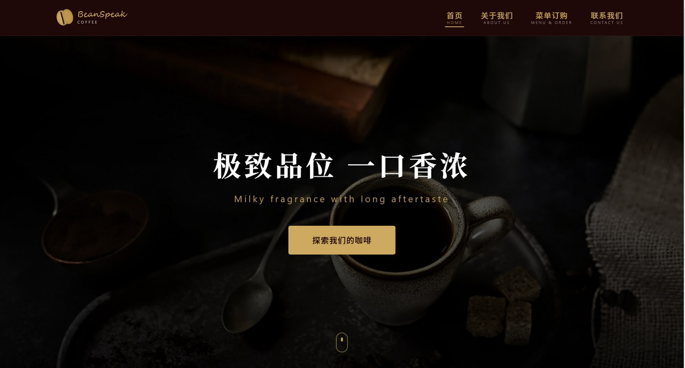

# 豆语咖啡 BeanSpeak Coffee · 品牌官网

> 极致品位，一口香浓。

**深酒红与香槟金构成的精品咖啡品牌官网**  
毕业设计作品 · 使用 Claude Code 辅助开发

[](https://developer.mozilla.org/zh-CN/docs/Web/HTML)
[](https://developer.mozilla.org/zh-CN/docs/Web/CSS)
[](https://developer.mozilla.org/zh-CN/docs/Web/JavaScript)
[](https://claude.com/claude-code)
[](#开发说明)

**[在线预览](https://morningluu.github.io/beanspeak-coffee-website/)** · **[源码仓库](https://github.com/morningluu/beanspeak-coffee-website)**



---

## 项目简介

「豆语咖啡 BeanSpeak Coffee」是一套面向精品咖啡品牌的官网设计。项目以“**让每一杯咖啡都有话可说**”为叙事出发点，把品牌故事、产品推荐、促销活动、菜单选购与门店联系串成完整的品牌体验。

视觉方向采用**深酒红背景 + 香槟金细节 + 衬线标题**，配合暗调咖啡摄影与大量留白，建立克制、成熟、有仪式感的品牌气质。首页使用全屏影像轮播，菜单页则引入可持久化的购物车，让静态网站具备接近真实点单流程的交互深度。

## 页面与功能

| 页面 | 文件 | 主要内容 |
| --- | --- | --- |
| 首页 | `index.html` | 全屏品牌轮播、特品推荐、促销活动折叠卡、门店环境展示、页脚信息 |
| 关于我们 | `about.html` | 品牌主张、三款代表产品轮播、品牌历程时间线、工艺理念 |
| 菜单订购 | `menu.html` | 商品分类、菜单卡片、分页、规格与价格、购物车、下单提示 |
| 联系我们 | `contact.html` | 门店地址、电话、邮箱、营业时间、留言表单与逐项校验 |

### 核心交互

- **全屏品牌轮播**：首页 hero 支持自动切换、前后按钮和底部指示点，画面带淡入位移效果。
- **产品轮播**：关于页的招牌产品介绍使用独立轮播，支持上一款 / 下一款。
- **促销手风琴**：三组活动默认收起，点击“展开详情”后展开完整活动规则，控制首屏信息密度。
- **菜单筛选与分页**：按全部 / 玄米拿铁 / 沫茶拿铁 / HOJICHA / 冷饮 / 热饮分类筛选，配合分页浏览。
- **购物车本地持久化**：使用 `localStorage` 保存购物车，支持加购、数量增减、删除、清空、合计与下单提示；刷新后仍保留。
- **表单校验**：联系页对姓名、邮箱、留言进行前端校验，错误信息就地显示。
- **滚动与导航反馈**：滚动时导航背景与购物车徽标同步更新。

## 设计说明

- **品牌色**：`#6D1A1A` 深酒红、`#D4A853` 香槟金、`#2D0A0A` 暗棕红，形成温暖但克制的层次。
- **字体**：标题使用 Georgia 系列衬线字体，正文使用系统无衬线字体，兼顾品牌感与可读性。
- **影像**：咖啡豆、手冲、空间与产品摄影统一为暗调，金色只用于按钮、分隔线和关键信息。
- **版式**：宽幅 hero、居中大标题、细线分隔与充足留白，模拟高端餐饮品牌的画册节奏。
- **动效**：`fadeIn`、`scaleIn`、`heroFadeUp` 与滚动回弹，保持缓慢、优雅的观看节奏。
- **响应式**：14 组媒体查询，移动端重新排列导航、轮播与页脚信息。

## 技术栈

- **HTML5**：四个独立页面，共享顶部导航与页脚结构。
- **CSS3**：CSS 变量、Grid / Flexbox、渐变、背景叠加、过渡与关键帧动画。
- **JavaScript**：轮播、手风琴、菜单筛选、分页、购物车 CRUD、表单校验、滚动监听。
- **数据组织**：菜单商品与购物车逻辑分离，便于替换为真实接口。
- **零依赖**：不依赖框架或构建工具。

## 目录结构

```text
beanspeak-coffee-website/
├── index.html
├── about.html
├── menu.html
├── contact.html
├── css/
│   ├── common.css          # 设计变量、导航、页脚、通用组件
│   ├── home.css            # 首页
│   ├── about.css           # 关于页
│   ├── menu.css            # 菜单与购物车
│   └── contact.css         # 联系页
├── js/
│   ├── common.js           # 导航、滚动等公共逻辑
│   ├── home.js             # 首页轮播与活动折叠
│   ├── about.js            # 品牌轮播与时间线
│   ├── menu.js             # 商品筛选、分页、购物车
│   └── contact.js          # 表单校验
├── images/                 # 品牌与产品图片
├── svg icon/               # 图标资源
├── preview.jpg
└── README.md
```

## 本地运行

```bash
# 在项目根目录执行
python -m http.server 8000
```

访问 <http://localhost:8000>。也可以直接双击 `index.html`，但建议通过本地服务器浏览以完整加载资源。

## 开发说明

- **项目性质**：毕业设计 / 品牌官网静态网站设计
- **开发方式**：使用 **Claude Code** 辅助完成页面结构、样式与交互实现，由作者完成品牌内容、视觉方向与最终调整
- **设计关键词**：暗调、精品咖啡、品牌叙事、仪式感、克制的金色
- **浏览器支持**：Chrome、Edge、Firefox、Safari 等现代浏览器

## 演示内容声明

页面中的“豆语咖啡 / BeanSpeak Coffee”品牌、门店地址、电话、邮箱、产品价格、促销规则与备案号均为**毕业设计演示信息**，不对应真实门店或商业活动。图片素材仅用于学习与作品展示，版权归原作者所有；如有侵权请联系删除。

## 作者

[@morningluu](https://github.com/morningluu)
